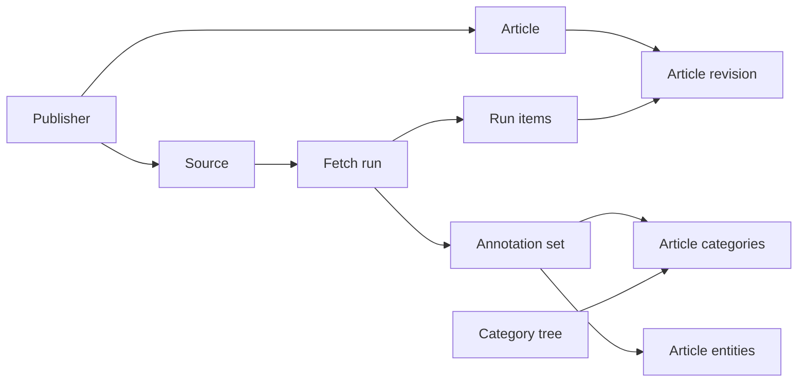

# News persistence

2026-10-31時点で、レビュー済みDDLに対応するGoモジュール・Store・単体テストと、
隔離MySQL 8.4用の統合テストを実装した。[schema.sql](schema.sql)が `Schema()` の入力であり、
[レビュー時のDDL案](schema.proposed.sql)は変更せず保存している。両者のDDL本文の一致をテストする。
MarketHub・SDKへの接続、アプリのマイグレーション、本番DB適用・デプロイは未実施。

## 目的と責務

金融専用ではないニュース保存機能を `storage/go/mysql/news` に置く。
一般ニュースアプリでも、政治・科学・スポーツ等の分類と、人物・企業・地域等の関連付けに使える。
K4K3RUは、その利用例として `finance/crypto` とAsset・Venueとの関連付けを登録する。

| 担当 | 責務 |
| --- | --- |
| storage | 汎用DDL、入力検証、取得履歴、記事の版、分類の版、整合性を保つ保存・検索 |
| 利用アプリ | 情報源の登録、HTTP取得・解析、カテゴリ・関連対象の判定、取得方針、マイグレーション、公開対象の選別 |
| MarketHub | SUI等のAsset対応、Mainnetの根拠、公開DTOへの変換、既存APIの利用制限・課金・Console連携 |
| 取得スキル | MarketHub APIとParquetの取得、入力スナップショットとmanifestの保存 |
| 分析・記事化スキル | 読者の疑問・データ品質に基づく題材選定、分析、根拠を追える下書き。記事化見送りも許容 |

storageはSDKの公開DTO、MarketHub、チェーンSDKに依存しない。取得クライアント、LLM、
クローラー、スケジューラー、推薦・個人化、読者行動の保存は含めない。
記事全文・SNSプロフィールの収集や、自動課金API利用もこの実装範囲に含めない。

## DDLの構成

MySQL 8.4 / InnoDB、UTCの `DATETIME(6)` を対象とする。
一般名は `news_*`、K4K3RUでは `market_hub_news_*` とする。
DB・接続・適用手順は利用アプリが所有し、storageのコンストラクターはDDLを実行しない。
接続は `parseTime=true`・`loc=UTC` とUTCのDBセッションを使う。

| テーブル | 保存内容・主な関係 |
| --- | --- |
| `news_publishers` | 発行元。1発行元が複数のRSS・API・言語別ソースを持てる |
| `news_sources` | 取得口、形式、言語ヒント、設定の版、有効状態。Assetに固定しない |
| `news_fetch_runs` | ソースごとの取得試行、開始時設定、解析器の版、結果・件数・応答ハッシュ |
| `news_articles` | 発行元内で識別した記事。元IDまたは正規化URLと識別方式を保持 |
| `news_article_revisions` | タイトル・URL・提供要約・時刻等の不変な版 |
| `news_fetch_run_items` | 各取得で観測した記事と、その時点の版。ソース内IDも保持 |
| `news_categories` | アプリが登録する階層分類。例：`finance` → `finance/crypto` |
| `news_annotation_sets` | 取得1回を入力とした分類結果の版。未分類・該当なしも記録 |
| `news_article_categories` | 分類結果の版に属する記事とカテゴリの多対多関連 |
| `news_article_entities` | 同じ版に属する記事とAsset・人物・地域等の多対多関連と根拠 |

前案の9テーブルに `news_annotation_sets` を追加する。記事メタデータが変わらなくても、
SUIへの関連付けやMainnetの根拠は訂正され得るため、取得し直さずに分類だけを更新できる。
分類結果を上書きすると過去の分析を再現できないため、この版を独立させる。
分類は当初ルールベースでよく、このテーブルはAI処理の導入を前提としない。



外部のAsset・人物マスターにはFKを張らない。内部の取得・記事・版・分類には複合FKを設け、
別発行元の記事や別取得の版を誤って関連付けることを防ぐ。
削除は `RESTRICT`。今回、自動削除・保持期限・全文検索の仕組みは追加しない。

## 記事の識別と版

- 記事の識別は `(publisher_id, identity_namespace, identity_value)`。
  `identity_namespace` は `canonical-url-v1` 等の明示した方式とする。
  発行元全体で有効と確認できたIDだけを共有し、フィード内GUIDを無条件に発行元共通IDにしない。
- `identity_sha256` は識別値のバイト列のSHA-256。`article_id` は発行元・方式・値を
  長さ付きで連結したバイト列のSHA-256とする。既存データのIDは移行時に別途対応付ける。
  ハッシュが一致しても保存済みの識別値を照合し、不一致は衝突エラーにする。
- 発行元をまたぐ転載や、似たタイトルを自動統合しない。同一発行元の複数ソースで版が異なる場合も、
  観測元・取得時点を残し、勝手に「最新」を選ばない。同一取得内の競合する重複は保存前にエラーにする。
- `record_json` は正規化済みJSONの**そのままのUTF-8バイト列**を保存する `MEDIUMTEXT`。
  `revision_sha256` はこのバイト列のSHA-256。MySQLのJSON型による表現変更をハッシュ対象にしない。
  エンコーダーを固定し、キー順・時刻表現を一定にする。意味的に等しいJSONの自動統合は保証しない。
- レコードv1はタイトル、HTTPSの正規化URL、提供元の短い要約、言語、公開時刻、更新時刻、
  任意の著者・画像URL・出来事の時刻・提供元属性を持つ。取得時刻や後付けの分類は含めない。
  要約は提供元の要約であり、本文取得やAI生成要約を暗黙に行わない。
- `record_version` はJSON内の版と一致させる。検索用の言語・公開時刻・更新時刻の列もJSONと照合する。
  欠損時刻はNULLのまま保持し、取得時刻で補完しない。読取り時もJSONとハッシュの一致を検証する。

記事A→修正B→再びAとなった場合、2つの版と3回の取得への関連が残る。
応答ハッシュは元RSS/JSONの指紋に限る。応答本文は保存しないため、元レスポンスの再解析まで
再現できるとは表現しない。発行元表示・取得URL等の当時の情報は `source_snapshot` に固定する。
認証情報・非公開の設定・HTTPヘッダーは保存対象外。

## カテゴリ、関連対象、分類の版

カテゴリキーは小文字英数字・ハイフンの区切りを `/` で連結した不変キーとする。
最大255バイト・8階層。親は末尾1区切りを除いたキーと一致させる。
親・キーの付替えは行わず、分類体系変更時は別キーを登録して旧分類を無効化する。
storageが `finance` や `crypto` を自動登録することはない。

| 区別 | K4K3RUでの例 | 一般ニュースでの例 |
| --- | --- | --- |
| カテゴリ | `finance/crypto` | `science/space`, `sports/football` |
| 関連対象 | 名前空間 `k4k3ru.asset` / キー `sui` | 名前空間 `wikidata` / 当該人物等のID |
| 追加の関連対象 | `k4k3ru.venue` / `cetus` | 同一記事に登場する企業・地域 |
| 適用範囲の根拠 | MarketHub定義のMainnet判定と根拠 | 利用アプリ固有の地域・対象条件 |

名前空間はASCII、関連対象キーは最大512バイトで大文字小文字を保持する。
カテゴリは複数付与でき、カテゴリと関連対象は別々に検索する。
分類根拠のJSONはアプリが意味を定義し、storageはMainnetや需要の真偽を判断しない。

分類結果は `(run_id, profile_key)` ごとに版を追加する。例えばMarketHubが
`k4k3ru-news-mainnet-v1` という用途を定義し、ルール版を `producer_version` に残す。
`document_json` は次の情報を持つ正規化JSONで、保存バイト列をハッシュ化する。

- 入力の取得ID、全記事のIDと入力版、分類プロファイル、生成器の版。
- 記事ごとのカテゴリ、関連対象、判定方法・根拠。判断不能は理由付き `unclassified`、
  対象なしの判断完了は `classified` と空配列で区別する。
- カテゴリ・関連対象の関連テーブルは、このJSONと一致する検索用の列。
  全入力記事をちょうど1回ずつ記録し、件数・入力版・関連内容が一致しなければ完了させない。

全体を1トランザクションで確定し、完了後の上書きは禁止する。
分類処理の失敗を「全件対象なし」として扱わない。完了した未分類結果は読めるが、
MarketHubの公開条件を満たしたことにはならない。

## 保存APIとトランザクション

[既存のselfcustody Store](../wallet/onchain/selfcustody/store.go)に合わせ、接続・トランザクションは
呼出側が所有する。以下をGo APIとして実装している。

| 操作 | 契約 |
| --- | --- |
| `NewStore(prefix)` / `Schema()` | 名前を検証してDDLを返す。DB接続・DDL実行・グローバル状態への依存なし |
| `RegisterPublisher` / `RegisterSource` / `RegisterCategory` | caller-owned transactionに保存。識別・所属は不変。ソース設定更新は版の一致を確認 |
| `BeginFetch` / `CompleteFetch` / `FailFetch` | 取得状態を遷移。完了時に記事・版・取得への関連をまとめて保存 |
| `BeginAnnotation` / `CompleteAnnotation` / `FailAnnotation` | 完了した取得のみを入力に、分類JSONと関連をまとめて保存 |
| `GetFetch` / `GetAnnotation` / `GetRevision` | ID指定の検証・再読取り。失敗と不存在を区別 |
| `LatestReady` / `ListPinnedObservations` | 完了取得＋完了分類の組を選び、その固定入力だけを検索・ページング |

複数行を書き込む公開メソッドは `*sql.Tx` を要求し、`*sql.DB` による行ごとの自動コミットを防ぐ。
StoreはCommit/Rollbackを呼ばない。読取りは既存の `storage/go/api.Executor` を使う。
時刻・ID・分類結果は呼出側が渡す。共有ライブラリ内でHTTP取得、ログ出力、再試行を行わない。

取得フローは「開始を短いTxで記録 → Tx外でHTTP取得・解析 → 完了Tx」の順。
分類も開始・計算・完了を分離する。失敗時は完了TxをRollbackし、別Txで失敗を記録する。
同一ソースの実行中取得は1つ、同一取得・プロファイルの実行中分類も1つに制限する。
DBのUNIQUE制約と、状態行のロック・比較更新で同時実行を制御する。
強制終了で残った `running` は明示的に失敗処理してから再開し、期限だけで自動奪取しない。
Commit応答が不明な場合はID指定で再読取りし、成功を確認するか運用者へ報告する。
完了済みIDへの再送は保存内容が同じ場合のみ成功として扱い、違う内容への書換えは拒否する。

初期上限：1取得1,000記事、1記事レコード16KiB、1分類文書2MiB、
1記事あたりカテゴリ・関連対象それぞれ16件、分類根拠4KiB・対象関連の根拠8KiB。
合計も文書上限以内に収める。超過はエラーとし、切り捨てた結果を完全な取得として保存しない。
SQLのCHECK/FKは行と関連の整合性を守り、ハッシュ・JSON投影・全入力網羅・不変性はStoreでも検証する。
任意SQLや任意JSONパスを受け付ける汎用検索APIは設けない。

## 読取りと再現条件

入力を `(run_id, annotation_set_id, response_sha256, document_sha256)` の組で固定する。
分類プロファイル、フィルター、並び順も固定し、別分類の結果に途中で差し替えない。
後の取得失敗・分類訂正は旧スナップショットを変更しない。

検索はカテゴリの完全一致／子孫、関連対象の名前空間とキー、言語、公開時刻の `[from,to)` に限定する。
子孫検索は `/` 境界を確認し、`finance/crypto` が `finance/cryptography` に一致しないようにする。
時刻範囲指定時は公開時刻不明を除き、その件数を別途返す。無指定時は不明を末尾に置く。
公開時刻降順、article ID、run IDで順序を確定する。1ページ最大100件、1検索最大16組の入力とする。
同一記事の複数ソース観測は帰属付きで返し、storageでは黙って重複除去しない。

初期の `LatestReady` はソースごとの最新の完了取得＋指定プロファイルの完了分類を選ぶ。
最新取得の分類が未完了・失敗なら旧完了組を選ぶが、最新試行の状態と使用入力の古さを別途返す。
過去の入力はID指定で検索できる。一方、全保存期間の全文検索・Web全体の網羅・推薦フィードは
初期APIの範囲外。一般ニュースアプリ向けにも、まず保存と明示した入力の検索を共通化する。

現在の情報源の状態と当時の固定メタデータは分ける。source/categoryの無効化は履歴削除ではなく、
内部再現用の読取りを妨げない。公開APIでの非表示・掲載撤回は利用アプリの方針で別に扱う。

## K4K3RUへの接続と移行

1. Sui Blog RSSとSui Statusの登録・取得器をMarketHubが所有する。`finance/crypto` 等も
   MarketHubの登録処理で用意する。既存の取得範囲・通信制限を維持し、新しい情報源は追加しない。
2. SUIへの関連とMainnetの根拠を記事の版ごとに分類する。カテゴリや公式ソースという理由だけで
   Mainnetにはしない。Blogの不明な項目は引き続き公開対象外。一般的なエコシステムニュースの
   追加掲載は、現行Mainnet限定方針を変更する別レビュー事項とする。
3. MarketHubが `MarketHub.News.List` のDTOへ変換する。Mainnet判定を公開ページングの前に行い、
   件数・hasMoreも同じ条件で計算する。内部では上限付きの観測を100件単位で処理し、
   途中の読取り失敗を部分的な正常応答にしない。既存の料金・認証方針は維持する。
4. 公開スナップショットv2では取得IDと分類ID、フィルターを固定する案とする。
   公開item IDは既存のソース内IDに基づく方式を維持し、共通storageのarticle IDと区別する。
   公開revisionも既存形式のメタデータから生成し、storageの元記事ハッシュと混同しない。
   新しい分類ID・元記事ハッシュ・分類状態の公開方法はSDKの追加項目案として実装前にレビューする。
5. Consoleは「取得状態」と「分類状態」を区別する。取得成功・分類失敗を「ニュースなし」にしない。
   取得スキルは新しい応答とsnapshotをそのままmanifest付きで保存し、旧版も読めるようにする。

既存の `002_asset_content` は書き換えず、追加のnewsマイグレーションを作る方針。
現在の本番DB適用状況はこの設計作業では確認していない。古いテーブルのDROPは含めない。
移行を実装する前に旧保存データの有無とID対応を確認し、既存取得・版の対応レポートを作る。
新規保存先を切り替えても、既発行のv1 snapshotは旧テーブル経由で読む互換経路を維持する案とする。
v1を新テーブルのIDとして解釈し直さない。既存manifestの書換えも行わない。
二重書込みや自動バックフィルは追加せず、移行手順と公開DTOの互換性を先に確定する。

## 実装順序と完了条件

| 段階 | 作業 | 確認する結果 |
| --- | --- | --- |
| 1 | DDL・保存契約のレビュー | この10テーブル、分類の独立した版、保存上限、移行方針を確認 |
| 2 | storageモジュール・Store・テスト | caller-owned Tx、immutable revision、分類版、境界条件・並行処理を検証 |
| 3 | MarketHub接続・移行案とSDK追加項目のレビュー後に実装 | 既存APIのID・課金・snapshot互換性、Mainnet条件を確認 |
| 4 | Console・取得スキルの接続 | 状態表示、旧/新応答の保存、manifestから入力の版を追跡可能 |
| 5 | 別途依頼された適用・実データ検証 | DB適用・取得完了とデータ品質を、ローカルテストと区別して記録 |

段階2はユーザー指定の **GPT-6.1-Sol / xhigh** で実装。`storage` のmain変更は許可済み。
K4K3RU本体は現在のtask branch/worktreeを使い、開始時に各リポジトリの差分を再確認する。
commit・push・PR・本番DB適用・デプロイはこの実装指示に含めない。

最低限の受入テストは次のとおり。

- 空フィード、A→B→A、同一記事の別ソース観測、別発行元の同名記事、記事識別の衝突拒否。
- 取得失敗／分類失敗／強制終了、同時開始、Commit応答不明。旧完了入力を保持して失敗を可視化。
- 分類だけの訂正、未分類・対象なし・処理失敗の区別、別run/版への関連拒否、古いsnapshotの再現。
- 他ジャンル・複数カテゴリ・多言語・関連対象なしの記事。crypto/Mainnetへの暗黙依存がないこと。
- 時刻NULL、同時刻ページング、JSON/ハッシュ/投影不一致、上限超過、親カテゴリの不正な関連。
- 隔離したMySQL 8.4でDDL・FK・CHECK・同時実行・rollbackを検証。`finished_at=NULL` の
  終了状態を拒否し、prefix付きDDLも確認。既存の `Schema()` とアプリDDLの一致テストも追加。
- Goは変更ファイルのgofmt、対象パッケージのtest/vet、必要なraceを実施。
  接続段階ではSDK composition、MarketHub、Console、取得スキルの関連テストとbuildを実施。
  外部APIはfake/fixture、DBは隔離環境を使い、本番接続でテストしない。

ローカル検証の実行手順と結果は下記を参照。既存contentの結果は流用していない。

## Goの利用契約

`NewStore("")` は `news_*`、`NewStore("market_hub_")` は `market_hub_news_*` を使う。
prefixはSQL識別子のASCII文字、最大25バイト。生成されるFK名を含めMySQLの64文字制限内に収める。
`Schema()` はDDL文字列を返すだけで、接続・実行・既存スキーマの更新は行わない。
DDLにはコメントと文字列内のセミコロンがあるため、単純な `strings.Split(ddl, ";")` で分割しない。

`RegisterPublisher` は完全一致の再送だけを許す不変登録。
`RegisterSource(source, expectedVersion)` は初回が `expectedVersion=0`・`RegistrationVersion=1`、
更新が `RegistrationVersion=expectedVersion+1`。所属publisherと作成時刻は変更できない。
同一内容・同一版の再送は成功し、古い版から異なる設定への更新は `ErrConflict` になる。
`RegisterCategory` はキー・親・作成時刻を固定し、表示名と有効状態だけを変更できる。
Sourceの無効化後の新規取得は拒否するが、ID指定の履歴読取りと `LatestReady` は有効状態で隠さない。
公開可否は呼出側で選別する。

`BeginFetch` は登録済みsourceとpublisherから公開項目だけの `SourceSnapshot` を作る。
登録URLは認証情報を含まない公開HTTPS URLを呼出側が渡す。HTTPヘッダーや任意設定の保存口は設けない。
コンストラクター・Storeはネットワーク取得、ID生成、時計取得、再試行、ログ出力を行わない。
`CompleteFetch` に新規保存される記事・版の `first_observed_at` は、明示した `FinishedAt` を使う。
読取り結果の `Revision.FirstObservedAt` は不変の保存メタデータであり、JSONハッシュには含めない。
同一取得の完全一致した重複は1観測にまとめ、元ID・版・source item keyが競合する重複は拒否する。

`NewRevision(identity, record)` はRecord v1を検証し、固定フィールド順のJSONとSHA-256、
検索列を組み立てる。タイトル1,024バイト、提供要約8,192バイト、著者16件・各256バイトを上限とする。
`Record.Attributes` は深さ16以下のJSONオブジェクト。重複キーを拒否し、キーをソートする。
URLはHTTPSのみ。hostの小文字化、`:443` 除去、空pathの `/` 化、fragment除去を行う。
queryの順序・重複、path・escapingは発行元の意味を保つため並べ替え・削除しない。
`canonical-url-v1` のidentity valueは、この正規化を済ませたURLに限る。

すべての時刻はUTCに正規化してMySQLの西暦1000〜9999年・マイクロ秒精度に収まることを検証する。
欠損はnil/JSON項目省略、空の任意文字列・著者配列はJSON項目省略として固定する。
言語は35バイト以下のASCIIタグ構文を検証し、登録表・aliasの解決は行わない。
大文字小文字を保つため言語フィルターは完全一致（`en-US` と `en-us` は別）とする。

`EncodeDocument` はDocument v1の判定・関連を安定キー順に並べ、空配列を明示してJSONとSHA-256を返す。
`classified` の空配列は「対象なし」、`unclassified` は1,024バイト以内の理由必須で関連は空配列。
根拠JSONは深さ16以下のオブジェクト。MySQL JSON投影で数値表記が変わっても、文書の元バイト列は保持し、
関連表との比較は浮動小数点への丸めをせず有理数として行う。
投影根拠の整数はsigned/unsigned 64-bit以内、小数はbinary64の最短十進表記との数学的値が一致するもの、
指数は `[-324,308]` に限定する。例えば `1.00`・`1e3`・`0.1`・整数 `9007199254740993` は保存できる。
丸めが必要な `9007199254740993.0` や範囲外の値は拒否し、精度が必要な値はJSON文字列で表す。
この数値制限はJSON型へ投影する根拠にだけ適用し、TEXTとして保存する記事属性には適用しない。

`ListPinnedObservations` は1取得につき1分類版だけを受け取り、入力・profile・フィルター・並び順を
SHA-256でcursorに固定する。入力順序とページサイズを変えても同じ検索を続けられる。
最大16,000観測を走査し、候補記事は最大101件だけ保持する。分類文書は入力ごとに検証して扱う。
`Page.Total` はcursor前も含む条件一致件数、`UnknownPublishedCount` は時刻以外の条件に合う時刻不明件数。
日時範囲指定時だけ時刻不明を結果から除く。関連表・JSON・ハッシュの検証中に失敗した場合も部分成功は返さない。
`LatestReady` はソースID順で返し、`Stale` と選択・最新試行それぞれの明示時刻を返す。
経過時間の計算と許容する古さは呼出側の時計・方針に委ねる。
複数の読取りを同じDBスナップショットに揃える場合は、呼出側のread transactionをexecutorに渡す。

すべての書込みメソッドは、**どのエラーでも呼出側がそのTx全体をRollbackする**契約。
Storeは部分書込みの自動復旧をしない。Commit応答不明の場合は新しい接続・TxでID指定読取りを行い、
保存内容を確認してから完全一致の再送を判断する。失敗処理も別のTxで行う。
`ErrNotFound` と `sql.ErrNoRows` の双方を `errors.Is` で検査できる。
`ErrInvalid`・`ErrConflict`・`ErrIntegrity` も検査でき、DBエラーのchainを保持する。

次の例は接続済みDB、登録済みsource、呼出側で用意したID・時刻・fixtureの取得結果を使う。
同じコードを [コンパイル対象の例](example_test.go) に置いている。

```go
func persistFetchedNews(ctx context.Context, db *sql.DB, store *news.Store,
    start news.FetchStart, completion news.FetchCompletion) error {
    apply := func(write func(*sql.Tx) error) error {
        tx, err := db.BeginTx(ctx, nil)
        if err != nil {
            return fmt.Errorf("failed to begin news transaction: %w", err)
        }
        if err := write(tx); err != nil {
            return fmt.Errorf("failed to persist news transaction: %w", errors.Join(err, tx.Rollback()))
        }
        if err := tx.Commit(); err != nil {
            return fmt.Errorf("failed to commit news transaction: %w", err)
        }
        return nil
    }
    if err := apply(func(tx *sql.Tx) error { return store.BeginFetch(ctx, tx, start) }); err != nil {
        return err
    }
    return apply(func(tx *sql.Tx) error { return store.CompleteFetch(ctx, tx, completion) })
}
```

実際の取得では開始を記録してからTx外で外部取得・解析を行い、completionを組み立てる。
記事は `NewRevision(identity, Record{Version: 1, Title: "...", URL: "https://example.org/news"})` で作成し、
`FetchCompletion.Items` にidentityとsource item key付きで渡す。

## ローカル検証

このモジュールは親workspaceへ暗黙追加しない。モジュールディレクトリで `GOWORK=off` を付けて実行する。
通常の `go test ./...` は単体テストと例を実行し、明示的なDB指定がなければMySQLテストをskipする。
統合テストは次の両方を要求し、loopback TCP・DB名 `news_storage_test`・MySQL 8.4も確認する。

```sh
export K4K3RU_NEWS_TEST_ISOLATED=1
export K4K3RU_NEWS_TEST_DSN='root@tcp(127.0.0.1:3306)/news_storage_test?parseTime=true&loc=UTC'
GOWORK=off go test -count=1 -run MySQL -v ./...
```

指定先は必ず使い捨てのDBとし、本番・共有DBを渡さない。テストは一意prefixの10テーブルを作成し、
終了時にそのテーブルだけを削除する。Docker起動・イメージ取得・DB作成はテストが行わない。
テスト内のDB接続ではUTC・parseTime・DDL用multiStatements・短い接続/ロック待ち上限を明示する。
DDLとschema.sqlの対応は単体テストで確認する。アプリ側DDLは未追加のため、その一致検証は段階3で追加する。

2026-10-31の確認結果は以下のとおり。既存contentの結果は流用していない。

- `gofmt`、`GOWORK=off GOPROXY=off go test ./...`：成功（MySQL指定なしは明示skip）。
- 隔離MySQL 8.4.13上の `go test -count=1 -run MySQL -v ./...`：成功。
- `GOWORK=off GOPROXY=off go vet ./...`、`go build ./...`：成功。
- 同じオフライン設定と隔離DB指定で `go test -race -count=1 -v ./...`：15テスト・1実行例が成功（2.022秒）。

検証時は書込み可能な `GOCACHE=/private/tmp/k4k3ru-news-gocache` を明示した。
隔離DBは使い捨てMySQL 8.4.13のtmpfs上で実行し、検証後にコンテナを削除した。

本番DB、外部API、MarketHub/SDK/Consoleの接続・料金・公開snapshot互換性はこの段階の検証対象外。
